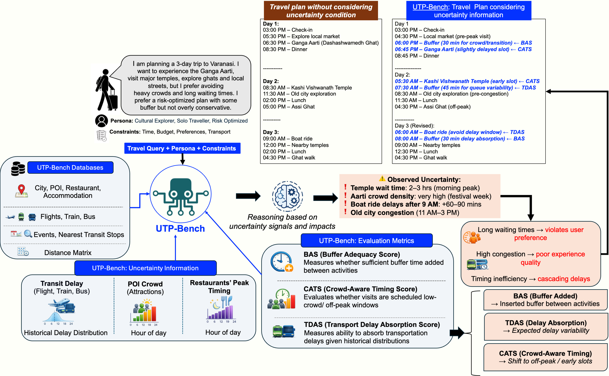

<div align="center">

<h1 align="center">🌍 UTP-Bench: Uncertainty-aware Travel Planning Benchmark</h1>

[](PAPER_URL)
[](https://arxiv.org/abs/2609.02421)



</div>

## 📢 News

* 🎉 **UTP-Bench** has been accepted to EMNLP( Findings 2026).

---

# 🌍 UTP-Bench: Uncertainty-aware Travel Planning Benchmark

This is the official implementation of **UTP-Bench**, a large-scale benchmark for evaluating **uncertainty-aware travel planning with Large Language Models (LLMs)**.

UTP-Bench addresses a key limitation of existing travel-planning benchmarks: they primarily evaluate itinerary feasibility under deterministic conditions, while real-world travel is inherently uncertain due to **transportation delays, crowd fluctuations, and unexpected disruptions**.

Our benchmark integrates real-world travel data across **504 cities in India**, together with empirical transportation-delay distributions and crowd-density patterns, enabling the evaluation of travel itineraries under realistic uncertainty.

---


## 🧭 UTP-Bench Overview

Existing travel-planning benchmarks such as TravelPlanner and TripCraft primarily assume deterministic environments with fixed transportation schedules and static travel conditions.

However, real-world travel involves uncertainty:

* ✈️ Transportation delays
* 🚆 Train and bus disruptions
* 🚕 Road-traffic delays
* 👥 Crowd fluctuations
* ⏱️ Variable activity durations
* 🔄 Cascading schedule disruptions

UTP-Bench explicitly models these uncertainties and evaluates whether an itinerary remains **robust**, rather than merely checking whether it is feasible under ideal conditions.

### ✨ Key Contributions

**1. Uncertainty-aware travel planning benchmark**

UTP-Bench contains **1,000 real-world travel queries** spanning 3-, 5-, and 7-day itineraries. Each query is paired with a **human-annotated gold-standard itinerary**.

**2. Real-world uncertainty modeling**

The benchmark incorporates empirical delay statistics for transportation and crowd-density patterns for attractions and restaurants, allowing travel plans to be evaluated under realistic stochastic conditions.

**3. Risk-aware traveler profiles**

UTP-Bench models three different uncertainty preferences:

* 🟢 **Risk-Tolerant** — accepts tighter schedules and smaller buffers.
* 🟡 **Risk-Optimized** — prefers a balanced schedule with moderate buffers.
* 🔴 **Risk-Averse** — prefers conservative planning with larger safety margins.

**4. Uncertainty-aware evaluation**

We introduce three new metrics:

* ⏱️ **Buffer Adequacy Score (BAS)**
* 👥 **Crowd-Aware Timing Score (CATS)**
* 🚆 **Transport Delay Absorption Score (TDAS)**

These metrics measure whether an itinerary can remain robust under temporal, crowd, and transportation uncertainties.

---

## 📊 Dataset Statistics

UTP-Bench integrates multiple real-world travel components:

| Component                      | Entries |
| ------------------------------ | ------: |
| 🏙️ Cities                     |     504 |
| 🗺️ States & Union Territories |      33 |
| ✈️ Flights                     |  29,346 |
| 🚆 Trains                      |  68,068 |
| 🚌 Buses                       |  34,925 |
| 🍽️ Restaurants                |   3,433 |
| 🏛️ Attractions                |   2,990 |
| 🏨 Accommodations              |   3,670 |
| 🎭 Events                      |     783 |
| 🚉 Nearest Transit Stops       |  10,025 |


---

## 🗺️ Benchmark Structure

UTP-Bench contains travel queries across three planning horizons:

| Planning Horizon | Geographic Scope              |
| ---------------- | ----------------------------- |
| **3-day**        | Single destination city       |
| **5-day**        | Two cities within one state   |
| **7-day**        | Three cities within one state |

Each query contains structured planning information including:

* Departure city
* Destination
* Travel dates
* Budget
* Traveler persona
* Risk profile
* Hard constraints
* Commonsense constraints
* Uncertainty constraints

Queries are generated using GPT-5 in a few-shot setting to produce diverse but structurally controlled travel-planning scenarios.

---

## 👤 Traveler Personas

Each query is associated with a traveler persona covering:

* **Traveler Type**
* **Purpose of Travel**
* **Spending Preference**
* **Location Preference**
* **Risk Profile**

Examples of location preferences include beaches, mountains, heritage cities, wildlife destinations, and religious sites.

The risk profile determines how much uncertainty the traveler is willing to tolerate and influences the amount of temporal buffering and itinerary density considered appropriate.

---

## ⚠️ Uncertainty Modeling

UTP-Bench introduces uncertainty constraints based primarily on **transportation delays** and **crowd-induced variability**.

### 🚆 Transportation Uncertainty

Historical delay information is incorporated for:

* Flights
* Trains
* Buses
* Cabs / road transportation

These signals allow the benchmark to evaluate whether an itinerary provides sufficient buffer to absorb realistic delays.

### 👥 Crowd Uncertainty

Crowd-density patterns are modeled across attractions and restaurants.

Plans that schedule activities during highly congested periods without sufficient adjustment can receive lower uncertainty-aware scores.

This enables UTP-Bench to evaluate **crowd-sensitive scheduling** rather than treating activity duration as deterministic.

---

## 📏 Evaluation Metrics

UTP-Bench uses an eight-metric evaluation suite combining existing travel-planning metrics with three newly proposed uncertainty-aware metrics.

### Existing Metrics

* **Temporal Meal Score (Tmeal)**
* **Temporal Attraction Score (Tattr)**
* **Spatial Score (Sspatial)**
* **Persona Score (Ppersona)**
* **Ordering Score (Oord)**

### 🆕 Uncertainty-aware Metrics

#### ⏱️ Buffer Adequacy Score — BAS

Measures whether the temporal buffers allocated around activities are appropriate given:

* Expected visit duration
* Crowd congestion
* Traveler risk tolerance

A higher BAS indicates better alignment between allocated buffers and expected uncertainty.

#### 👥 Crowd-Aware Timing Score — CATS

Measures how effectively an itinerary schedules visits around crowd conditions.

Higher CATS indicates that activities are more consistently scheduled during favorable, less crowded periods.

#### 🚆 Transport Delay Absorption Score — TDAS

Measures whether transportation buffers are sufficient to absorb realistic historical delays without propagating disruptions to subsequent activities.

A higher TDAS indicates that transportation buffers are better aligned with expected delays.

---

## 🧪 Experiments

We evaluate state-of-the-art LLMs under UTP-Bench across **3-day, 5-day, and 7-day** travel-planning scenarios.

The evaluated models include:

* **GPT-5**
* **Qwen3 (14B)**
* **Mistral-7B-Instruct-v0.3**
* **Phi-4-mini-Instruct**

The experiments use uncertainty-aware prompts containing POI information, traveler risk profiles, congestion information, and transportation-delay statistics.

---


---

## 🧩 Why UTP-Bench?

Traditional travel-planning evaluation asks:

> **"Is this itinerary feasible?"**

UTP-Bench asks a more realistic question:

> **"Will this itinerary remain robust when the real world does not go exactly as planned?"**

This shift moves travel-planning evaluation from **deterministic constraint satisfaction** toward **robust planning under uncertainty**.

---

## 🔓 Dataset Access

The paper describes UTP-Bench as a benchmark built from real-world travel data, including transportation, attractions, restaurants, accommodations, events, transit stops, and distance information.

### 📥 Download

The **UTP-Bench augmented dataset** is available at the following Google Drive link:

👉 **[Download the UTP-Bench Augmented Dataset](https://drive.google.com/drive/folders/1cwdHMjBznyYOluKoxOiKu1RtVseZpgYy?usp=sharing)**

---

## 🛠️ Setup

Clone the repository:

```bash
git clone https://github.com/ETCHARLAREVANTHRAO/UTP-Bench.git
cd UTP-Bench
```

> **Note:** The paper identifies this repository as the official code base, but does not specify the exact environment creation commands in the paper. 

---

## 🚀 Running

UTP-Bench evaluates LLM-generated travel itineraries across different planning horizons and traveler risk profiles.

The benchmark supports evaluation under:

```text
3-day
5-day
7-day
```

```

---

## 📊 Evaluation

UTP-Bench evaluates generated itineraries using both conventional travel-planning metrics and uncertainty-aware metrics.

### Conventional Metrics

```text
Temporal Meal Score
Temporal Attraction Score
Spatial Score
Persona Score
Ordering Score
```

### Uncertainty-aware Metrics

```text
Buffer Adequacy Score (BAS)
Crowd-Aware Timing Score (CATS)
Transport Delay Absorption Score (TDAS)
```

The combination allows evaluation of **temporal, spatial, sequential, persona-specific, and uncertainty-aware** aspects of generated itineraries.

---


---

## 🎗️ Acknowledgement


We sincerely thank the annotators for their efforts in annotating, validating, and quality-checking the dataset.

---

## 📚 Related Work

UTP-Bench builds upon previous work in LLM-based travel planning, including:

* **TravelPlanner**
* **TravelPlanner+**
* **TripCraft**
* **TripTide**

Unlike deterministic travel-planning benchmarks, UTP-Bench explicitly models stochastic uncertainty using empirical transportation delays and crowd-density information.

---

## 📄 Paper

**UTP-Bench: Uncertainty-aware Travel Planning Benchmark**

**Authors:**
Etcharla Revanth Rao <sup>1</sup>, Priyanshu Karmakar <sup>1</sup>, Shubhojit Mallick <sup>2</sup>, Manish Gupta <sup>2</sup>, Shreya Ghosh <sup>1</sup>, Abhik Jana <sup>1</sup>


**Affiliations:**
1 IIT Bhubaneswar, India
2 Microsoft Research, India

---

## 👨‍💻 Contact

For questions, suggestions, or issues related to UTP-Bench, please open an issue in this repository.

---

## ⭐ If you find UTP-Bench useful

If UTP-Bench helps your research, please consider **starring ⭐ the repository** and citing our work.


```bibtex
@misc{rao2026utpbenchuncertaintyawaretravelplanning,
      title={UTP-Bench: Uncertainty-aware Travel Planning Benchmark}, 
      author={Etcharla Revanth Rao and Priyanshu Karmakar and Shubhojit Mallick and Manish Gupta and Shreya Ghosh and Abhik Jana},
      year={2026},
      eprint={2609.02421},
      archivePrefix={arXiv},
      primaryClass={cs.AI},
      url={https://arxiv.org/abs/2609.02421}, 
}
```

<p align="center">
  <b>UTP-Bench</b> — From deterministic travel planning to robust planning under uncertainty 🌍
</p>
